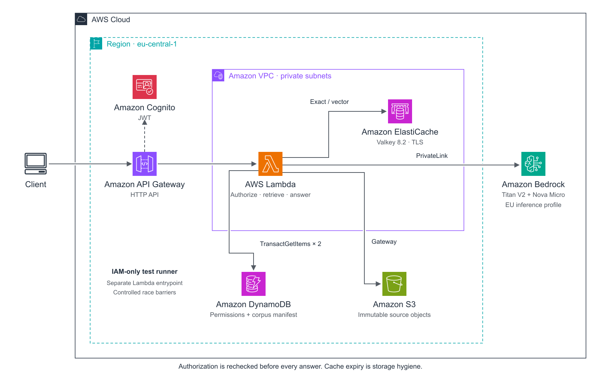

# Permission-Aware RAG Caching on AWS

[](https://github.com/bcfmtolgahan/aws-permission-aware-rag-cache/actions/workflows/checks.yml)

A runnable experiment with Amazon Bedrock, Amazon ElastiCache for Valkey, and a DynamoDB authorization boundary. It asks a specific question: **can we reuse an AI answer after permissions or its source corpus change, without relying on cache deletion?**

The repository contains the application, disposable Terraform infrastructure, local protocol tests, controlled AWS race tests, a three-arm benchmark, and the source for the diagrams. All business data is synthetic.



## What this implements

Every request gets a fresh authority snapshot before looking in the cache and another before returning an answer. Both cache hits and freshly generated answers must pass the final check. A change during the request returns `409 context_changed`; a missing or disabled entitlement returns `403`; an authority failure returns `503`. Cache failure falls back to authorized generation.

Cached answers are partitioned by tenant, current grants, corpus version, visible source metadata, and pipeline version. Each answer also records **all documents provided to the model**, independent of any citations it produces. A corpus publication invalidates the answer namespace even when every old dependency remains unchanged: a newly added document can change the answer too.

Semantic matching is deliberately bounded. Only four grammatical families of unqualified retention questions about the two fixture products are admitted. Dates, negation, audience qualifiers, and arbitrary questions use exact caching only. The similarity threshold is not an authorization check or proof that arbitrary questions are equivalent. For this tiny grammar, a direct intent-key cache would also work; vector search is included to exercise the real ElastiCache path, not because a vector index is necessary for eight fixture documents.

## Run locally

Use Python 3.12, [uv](https://docs.astral.sh/uv/), and Terraform 1.5 or newer. Local tests and the package build do not require AWS credentials. The deployed runtime is Python 3.12 on arm64. `rsvg-convert` is optional for PNG rendering; SVG generation uses the Python standard library.

```bash
git clone https://github.com/bcfmtolgahan/aws-permission-aware-rag-cache.git
cd aws-permission-aware-rag-cache
uv sync --locked
uv run pytest -q
uv run ruff check .
uv run python scripts/build.py
python3 scripts/diagrams.py
```

The locked `valkey` client is pure Python and packaged into the Lambda zip. Lambda supplies boto3; that managed runtime dependency is not pinned by `uv.lock`.

## Run the AWS experiment

First configure an existing AWS shared-config profile and the expected 12-digit account ID. Replace both example arguments with your own dedicated sandbox values:

```bash
uv run python scripts/cloud.py configure \
  --profile my-sandbox \
  --account-id YOUR_12_DIGIT_ACCOUNT_ID
```

`configure` only writes `.local/account.json` with owner-only file permissions; it makes no AWS calls. Cloud commands refuse to run without that file. They remove ambient AWS and Terraform overrides, use the configured profile, and verify its STS account against the account you supplied before proceeding. Terraform independently restricts the profile and allowed account. Repointing an existing checkout to another profile/account is refused; use a separate checkout.

Resources are confined to `eu-central-1`; Nova Micro uses an EU cross-region inference profile and may run in another supported EU region. The public evidence omits the original account, profile and resource identifiers.

For a complete disposable run, `uv run python scripts/run_experiment.py` builds, deploys, tests, benchmarks and destroys the stack. Its `finally` block also attempts cleanup after a failed test. An interrupted machine or failed destroy still requires the manual cleanup commands below.

```bash
uv run python scripts/build.py
uv run python scripts/cloud.py preflight
uv run python scripts/cloud.py init
uv run python scripts/cloud.py plan
uv run python scripts/cloud.py review
uv run python scripts/cloud.py apply
uv run python scripts/verify_deployment.py

uv run python scripts/lab.py seed
uv run python scripts/probe_admission.py
uv run python scripts/lab.py diagnostics
uv run python scripts/lab.py test
uv run python scripts/lab.py benchmark

uv run python scripts/cloud.py destroy
uv run python scripts/verify_cleanup.py
```

Use a dedicated sandbox with permission to create the stack and invoke the selected Bedrock models. Preflight performs a small embedding call and a generation call. Creating Valkey and Lambda VPC attachments can take several minutes. If an apply partially fails, keep the Terraform state and run `destroy`; do not delete the state first.

There is one `cache.t4g.small` Valkey 8.2 node, two private subnets, one Bedrock interface endpoint in two AZs, and S3/DynamoDB gateway endpoints. No NAT gateway is created. The node and interface endpoint incur charges while provisioned, including idle time. This is a disposable, single-node lab, with no cache failover, backup, or production availability claim.

`destroy` deletes the fixture bucket contents, users, cache, endpoints, logs, and other managed resources. `verify_cleanup.py` checks exact owned resources and writes a sanitized absence report. Billing records and service-side operational records are not resources the experiment can delete.

Lambda releases Hyperplane network interfaces asynchronously. The application security group depends on the execution policy so Terraform retains the role during that cleanup, with 30-minute subnet/group deletion timeouts. See [AWS's ENI cleanup guidance](https://repost.aws/knowledge-center/lambda-eni-find-delete). Keep the role and local state while the deletion is pending.

## Evidence and implementation

| File | Contents |
| --- | --- |
| [core.py](src/ragcache/core.py) | Scope calculation, admission grammar, retrieval, provenance, final check |
| [aws_adapters.py](src/ragcache/aws_adapters.py) | Transactional reads, immutable S3 verification, Bedrock and Valkey calls |
| [handler.py](src/handler.py) | JWT-authorized API entrypoint and separate IAM-only test entrypoint |
| [main.tf](infra/main.tf) | The complete disposable stack |
| [lab.py](scripts/lab.py) | Fixtures, actual HTTP authentication tests, controlled races, benchmark |
| [Protocol](docs/protocol.md) | Keys, consistency boundary, failures and limits |
| [Results](docs/results.md) | Measured results and what they do not establish |
| [Raw results](results/) | Sanitized machine-readable observations |
| [Security model](SECURITY.md) | Trust boundaries and production gaps |

The benchmark compares **no answer cache**, **permission-aware exact cache**, and **permission-aware exact + semantic cache**. All arms use the same authorization checks, retrieval and model. The sequential, repeated synthetic workload is a demonstration of cache behavior, not a production traffic estimate or an AWS service benchmark.

## Diagrams and sharing

The [architecture](docs/diagrams/architecture.svg) and [authorization flow](docs/diagrams/authorization-flow.svg) are editable SVGs, with PNG exports. They embed unmodified official AWS Architecture Icons. [Icon provenance](docs/icons/provenance.json) records the AWS download and release. The diagrams describe this experiment; they are not an AWS reference implementation or endorsement.

Code is MIT licensed. AWS icons retain AWS's applicable rights and usage terms; see [NOTICE](NOTICE). `scripts/package_public.py` builds a source archive from an allowlist and checks it for the pinned account ID and common secret formats. `.local/`, Terraform state and plans, credentials, generated passwords, and deployment outputs must never be committed.

Before sharing changes, run `uv run python scripts/audit_public.py --history` and inspect the source archive. The audit checks tracked files and Git history for common secret formats, personal email addresses, local home paths and deployment identifiers, without printing matched values. The package builder also compares files against private values from the local run when those are available. Pattern scans complement review; they are not a proof that arbitrary content contains no private data.

The checked-in results describe the recorded AWS experiment. The publication changes add explicit profile/account configuration and offline privacy checks; these were checked locally without repeating the AWS deployment. The application modules under `src/` still match the source hashes in `results/deployment.json`.

## Regenerate results and diagrams

```bash
uv run python scripts/report.py
uv run python scripts/diagrams.py
uv run python scripts/package_public.py
```

These commands rebuild the results document from the recorded JSON evidence, render the architecture and authorization flow, and package the source. They require no AWS credentials and do not rerun the cloud experiment.
