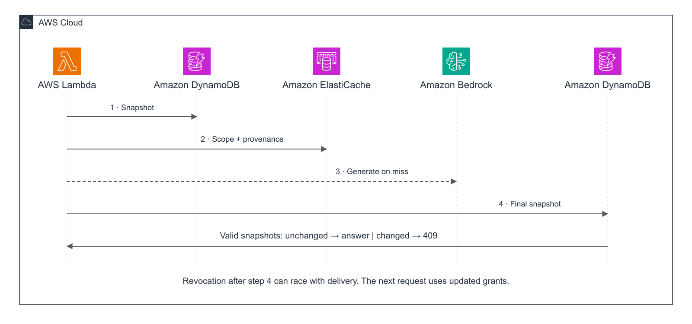

# Protocol and consistency boundary

## Scope and threat

The client has a valid Cognito JWT, but may no longer have the permissions it had when the token was issued. It may repeat another user's question, change product or tenant-related text, or send extra identity fields. The application must decide from current server-owned authority records, not JWT group claims or a cached authorization decision.

The experiment uses two synthetic tenants and four users. Within `acme`, Alice and Carol initially have `public` and `internal`; Bob has `public` only. Dana has both scopes in `globex`. Atlas's public/internal retention is 30/90 days in `acme`, and 14/180 in `globex`. Boreal uses different values. This makes an incorrect cross-permission or cross-tenant reuse observable.

## Request path

1. API Gateway validates the JWT signature, issuer and audience. Lambda takes the subject from the verified authorizer context. Request JSON accepts only `question` and `mode`.
2. A strongly consistent DynamoDB `GetItem` finds the subject's tenant. `TransactGetItems` then reads that user's permission record and that tenant's corpus manifest in one transactional snapshot. If the user moved tenant between these reads, the request is rejected.
3. Build a scope fingerprint. Try an exact candidate; for admitted questions only, embed the query and run a filtered Valkey vector search. Check the returned record's tenant, scope, pipeline, corpus version, contract and source dependencies again in Python.
4. On a miss, read only authorized immutable S3 objects. Verify their SHA-256 checksums, rank their stored Titan embeddings by cosine similarity, and pass the selected sources to Bedrock. Persist all model input source references as dependencies.
5. Read another authority snapshot. If its authorization stamp differs from the first snapshot, discard the candidate and return `409`. An inactive principal is denied. An unavailable authority never permits a cached fallback answer.
6. Optionally fill the cache, and return the answer with `Cache-Control: no-store`.



Each successful request performs two logical snapshots, each comprising a routing `GetItem` and one two-item `TransactGetItems` call. The benchmark records consumed capacity reported by DynamoDB rather than assuming a fixed RCU cost.

## Cache shape

```python
scope = sha256(canonical_json({
    "tenant": tenant,
    "corpus": corpus_version,
    "grants": sorted(current_grants),
    "pipeline": pipeline_fingerprint,
    "visible_documents": sorted(visible_document_metadata),
}))
exact_key = f"ragcache:{scope}:{sha256(canonical_json(original_question))}"
```

The implementation uses unmodified question strings for exact keys. Case-folding arbitrary questions can change meaning. Only the admission grammar normalizes case, spacing and trailing question punctuation.

The Valkey hash contains `scope` and `contract` TAG fields, the FLOAT32 embedding, and the complete answer/provenance JSON payload. HNSW uses 256 dimensions and cosine distance. The server generates both filter values as hex digests; client text is never interpolated into the search expression.

```text
(@scope:{<scope-sha256>} @contract:{<contract-sha256>})
    =>[KNN 3 @embedding $vec]
```

The implementation accepts candidates at cosine similarity >= 0.75 and performs the authorization checks independently. This threshold was selected after probing fixture embeddings, before the benchmark; it is not a calibrated production recommendation. The initial 0.88 choice rejected the target paraphrase (0.780), yet would admit a negated question (0.960) without the grammar check. The [probe data](../results/admission-probe.json) records this limitation. Approximate search can miss a valid entry; the fallback is generation. Exact hits avoid both query embedding and generation. Semantic hits avoid generation but still need a query embedding and final authority read. A semantic hit is not saved as a new exact alias.

On the tested ElastiCache for Valkey 8.2 engine, adding `SORTBY` to `FT.SEARCH` returns `Unexpected argument SORTBY`. The adapter uses native KNN ordering and reads the returned `__embedding_score` field. The IAM-only [compatibility probe](../results/vector-compatibility.json) exercises both forms on the real engine. A client library accepting a command does not establish that the managed engine supports every option.

Principal revision is intentionally absent from the shared scope: users with identical current, non-personalized source views may share. It remains in the per-request authorization stamp, so changing a user's grants and restoring them during a request still changes the revision. Source metadata includes scope, object key, topic and priority as well as the document hash and version. Writers must monotonically increment corpus versions; the metadata fingerprint provides additional protection against accidentally missed version updates for visible documents.

The pipeline fingerprint covers the declared prompt contract, model IDs, embedding dimensions, retrieval top-k, grammar contract, threshold and generation configuration. **A deployment changing code semantics must bump the corresponding contract version.** This lab does not implement automatic semantic version negotiation or recovery across incompatible deployments.

## Publishing sources

Upload an immutable object under `documents/<tenant>/<document>/<sha256>.json`, then conditionally replace the DynamoDB manifest and increment its version. Concurrent publishers use the prior version in the condition. Until the manifest is published, an uploaded object is not visible to retrieval. No event-driven cache eviction is required.

Here, immutable means content-addressed and hash-verified by the application protocol. S3 Object Lock and bucket versioning are not enabled. The operator can overwrite a key; the integrity test deliberately does so and verifies that a miss fails before sending those bytes to the model. A warm answer remains based on its original hash-verified source version until the authoritative manifest changes.

A tenant-wide corpus version is conservative: even an unrelated or currently invisible document update invalidates that tenant's cache namespace. This costs hit rate but avoids the subtle error where a newly added document changes an answer whose previous dependencies are still valid.

The manifest is intentionally small. DynamoDB's 400 KB item limit applies; an unbounded document catalog cannot use this schema. Retrieval is an in-process exact scan over the authorized fixture embeddings stored with S3 documents, capped at eight model input documents. It is not Amazon Bedrock Knowledge Bases or a scalable retrieval index. A production search index would need its own immutable publication/version contract, including additions and retrieval-policy changes.

## Revocation boundary

The final `TransactGetItems` snapshot is the authorization linearization point. It is not atomic with HTTP delivery. If revocation commits after this snapshot, an already-authorized response can still arrive afterward. The test suite explicitly pauses after final authorization, revokes access, then demonstrates this behavior. The next request uses the new permissions.

A slow cache fill after revocation writes to the old scope. A revoked user cannot read that scope on a subsequent request. Another currently authorized user with that same source view may legitimately reuse it. TTL is only storage hygiene. It neither grants access nor sets the revocation delay.

The protocol does not promise to cancel a Bedrock request already in flight, erase a user's earlier answer, or ensure revocation precedes the last response byte. Authority reads and model calls may disclose data to the configured model under the initial valid authorization even if delivery is later rejected. Work requiring stricter disclosure/cancellation semantics needs a different protocol.

## Failure table

| Condition | Behavior |
| --- | --- |
| Missing or modified JWT | API Gateway rejects before application execution |
| Unknown/disabled principal or no authorized sources | `403`, no answer |
| Authority revision or corpus changes during request | `409`, no answer; client may retry from scratch |
| DynamoDB unavailable | `503`, no stale authorization fallback |
| Valkey read/write unavailable | Continue with authorized generation; increment cache error count |
| Source SHA mismatch or Bedrock failure | `503`, no answer |
| Date/negation/audience qualifier | No semantic reuse; exact cache or fresh generation |
| Old cache entry after revocation | Different scope or rejected dependencies |

The IAM-only test function can pause execution at named barriers and inject an authority failure. These are controlled test hooks, not unauthenticated API options. Their injected failure result is not evidence that an actual DynamoDB outage was induced.

## AWS references

- [DynamoDB transaction APIs and isolation](https://docs.aws.amazon.com/amazondynamodb/latest/developerguide/transaction-apis.html)
- [ElastiCache vector search feature limits](https://docs.aws.amazon.com/AmazonElastiCache/latest/dg/search-features-limits.html)
- [ElastiCache semantic caching implementation](https://docs.aws.amazon.com/AmazonElastiCache/latest/dg/semantic-caching-implementation.html)
- [Amazon Nova Micro availability](https://docs.aws.amazon.com/bedrock/latest/userguide/model-card-amazon-nova-micro.html)
- [AWS Architecture Icons](https://aws.amazon.com/architecture/icons/)
